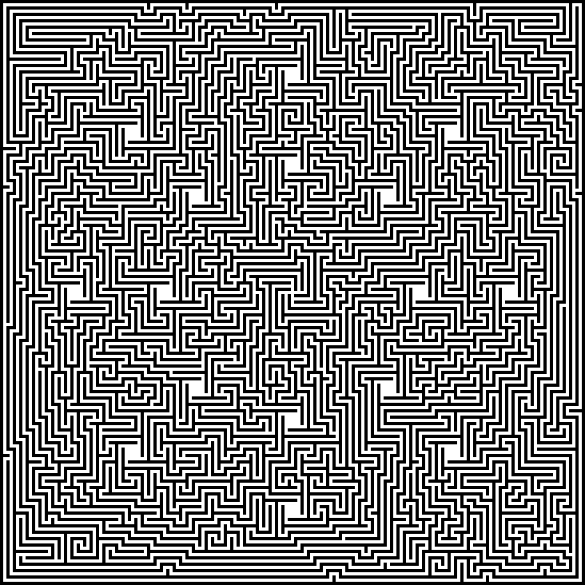
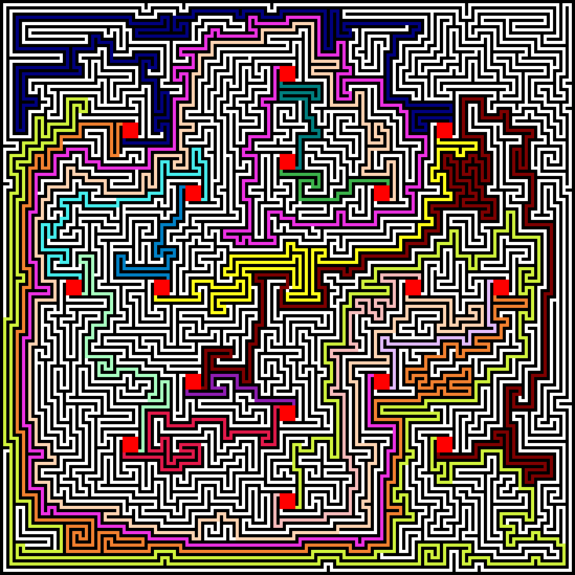

# Solution to [Possibly the Hardest Maze in Existence](https://www.reddit.com/r/mazes/comments/6oa2gr/possibly_the_hardest_maze_in_existence/)

## Here is the unsolved maze:


## and here is the solution generated by this script:


Run the script with
```bash
python hardest/solve_maze.py
```

# Other Various Fun Mazes
- `lines`
- `cars_and_dinos`
